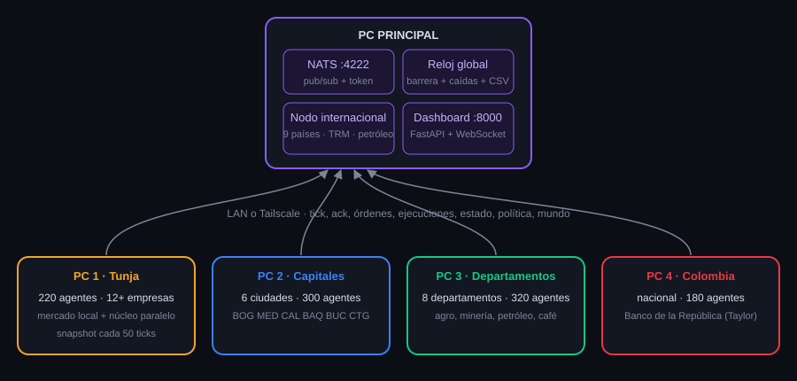
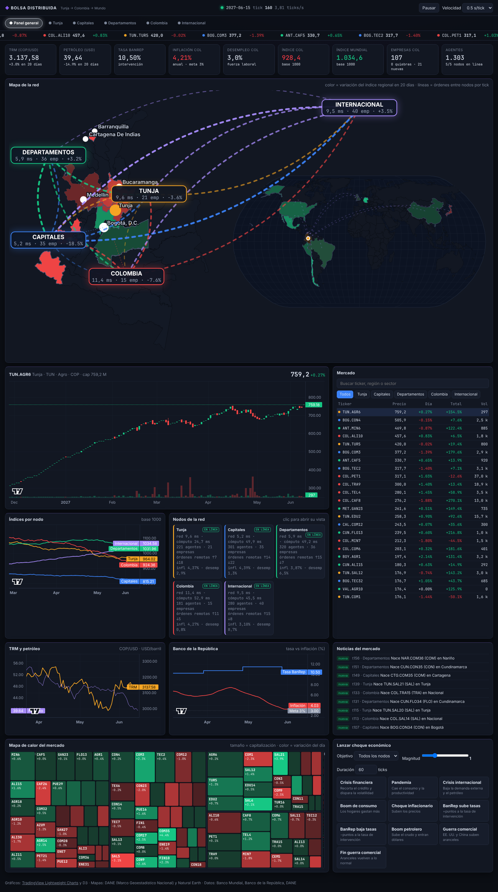
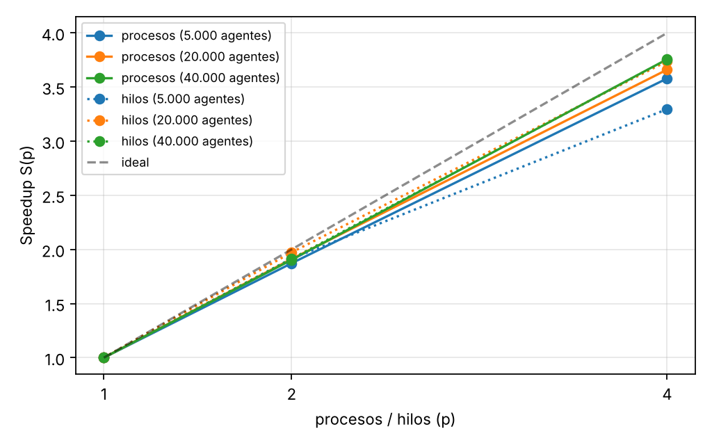

# Bolsa Distribuida: Tunja → Colombia → Mundo

Proyecto Integrador · Facultad de Ingeniería de Datos e IA · Universidad Santo Tomás, Seccional Tunja · 2026

**Autores:** Nicolás Cruz, Camilo Barbosa, Julián Sandoval, Sergio Campos y Daniel Ajiaco.

Integra **Computación Paralela y Distribuida**, **Redes e Infraestructura**, **Minería de Datos** y **Analítica de Datos**.

> © 2026 Los autores. **Todos los derechos reservados.** El código es visible para su evaluación académica, pero no se concede licencia para copiarlo, modificarlo ni reutilizarlo. Ver [LICENSE](LICENSE).

Un mercado tipo Wall Street con **más de 1.300 agentes** (hogares, empresarios, inversionistas, bancos y formadores de liquidez) que trabajan, consumen, compran y venden acciones, piden créditos, **quiebran** y **emprenden**. La economía está repartida en **5 nodos**, uno por computador, que se comunican por la red:

| Nodo | Qué simula | Quién lo corre |
|---|---|---|
| `tunja` | La economía de Tunja | PC 1 |
| `capitales` | Bogotá, Medellín, Cali, Barranquilla, Bucaramanga, Cartagena | PC 2 |
| `departamentos` | Boyacá, Antioquia, Valle, Cundinamarca, Santander, Meta, Nariño, Atlántico | PC 3 |
| `colombia` | Nivel nacional: grandes empresas y **Banco de la República** (regla de Taylor) | PC 4 |
| `internacional` | 9 países con reglas propias, petróleo y **TRM**; además el reloj global y el dashboard | PC principal (el tuyo) |

Todo arranca de **datos oficiales, públicos y gratuitos**: Banco Mundial (inflación, crecimiento, desempleo, tasas, tipo de cambio, recaudo, PIB per cápita de 10 países), la **TRM diaria del Banco de la República** (datos.gov.co, 730 días), el salario mínimo 2025 y la población del **Censo Nacional 2018 del DANE**. Los mapas son el Marco Geoestadístico Nacional del DANE (departamentos y los 123 municipios de Boyacá) y Natural Earth para el mundo.





### Vistas
| Dirección | Qué muestra |
|---|---|
| `/` | Panel general: mapa de la red (Colombia + mundo) con los 5 nodos y las órdenes que viajan entre ellos, KPIs, velas, mapa de calor, noticias y choques |
| `/nodo/tunja` | Boyacá con sus 123 municipios y Tunja resaltada, sectores de la ciudad, municipios más poblados |
| `/nodo/capitales` | Las seis capitales como burbujas sobre el mapa y su ranking |
| `/nodo/departamentos` | Coroplético de los ocho departamentos y su tendencia |
| `/nodo/colombia` | Mapa de inflación regional y la junta del Banco de la República (medidor vs meta 3%) |
| `/nodo/internacional` | Mapa mundial con los 9 países, sus reglas, TRM y petróleo |

## Reproducir los resultados del avance

Requisitos: Python 3.10 o superior (probado con 3.10 en Windows 11 y 3.13 en Linux). No hace falta instalar NATS aparte: lo trae `nats-server-bin`.

```bat
reproducir.bat            REM Windows
```
```bash
./reproducir.sh           # Linux / macOS
```

El script hace, en orden:

1. Crea el entorno `.venv` e instala `requirements.txt`.
2. Descarga los datos oficiales (Banco Mundial y TRM del Banco de la República) a `data/raw/` y regenera `config/semilla.json`. Si no hay internet, usa la `config/semilla.json` ya incluida (descargada el 30-oct-2026), que es la que produjo los resultados del documento.
3. Mide el módulo paralelo: `python -m analitica.benchmark` → `runs/benchmark/` (CSV, gráficas y datos del equipo).
4. Corre 250 ticks de la simulación distribuida completa (NATS + coordinador + 5 nodos) → `runs/<fecha>/`.
5. Genera el reporte analítico (`analitica.reporte`) y la minería de datos (`analitica.mineria`) sobre esa corrida.

Las semillas aleatorias están fijadas en `config/escenario.json` (`semilla_aleatoria`), y el módulo paralelo produce **exactamente la misma salida** con 1, 2, 4 o N trabajadores (el benchmark lo verifica antes de medir). Los estados `.pkl`, las corridas y los datos crudos no se versionan porque se regeneran con los pasos anteriores.

## Módulo paralelo (multiprocessing y threading)

`sim/kernel.py` contiene el núcleo de decisión de inversión: cada inversionista evalúa 8 activos con Monte Carlo (64 escenarios × 20 días) y calcula retorno esperado, CVaR 5 % y caída máxima. Es el cálculo más costoso de cada tick.

- **Descomposición de dominio:** los agentes se parten en sub-bloques de 256; cada sub-bloque tiene su propio generador aleatorio derivado de `(semilla, número de sub-bloque)`. Así el resultado no depende del número de trabajadores.
- **Balance de carga:** los sub-bloques se reparten en bloques contiguos casi iguales entre los trabajadores (`repartir`).
- **Dos modelos:** `Paralelo(p, "procesos")` usa `multiprocessing` (`ProcessPoolExecutor`) y `Paralelo(p, "hilos")` usa `threading` (`ThreadPoolExecutor`). Con `p = 1` corre la versión secuencial.
- En la simulación se activa con `--procesos N` (`python ejecutar_local.py --procesos 4` o `python -m sim.nodo --nodo tunja --procesos 0` para todos los núcleos).

```bash
python -m analitica.benchmark                 # 1, 2, 4, 8, ... y N; 5.000, 20.000 y 40.000 agentes
python -m analitica.benchmark --rapido        # prueba de menos de un minuto
benchmark.bat                                 # lo mismo en Windows
```

Métricas: speedup `S(p) = T(1)/T(p)`, eficiencia `E(p) = S(p)/p`, fracción serial de Karp-Flatt y ajuste de la ley de Amdahl. Mediana de 5 repeticiones.

Resultados en un equipo de 4 núcleos lógicos (Intel Xeon 2,1 GHz, Linux, Python 3.13), escalamiento fuerte:

| Agentes | p | Procesos: T (s) | S | E | Hilos: T (s) | S | E |
|---:|---:|---:|---:|---:|---:|---:|---:|
| 5.000 | 1 | 1,240 | 1,00 | 1,00 | 1,240 | 1,00 | 1,00 |
| 5.000 | 2 | 0,657 | 1,89 | 0,94 | 0,600 | 2,07 | 1,03 |
| 5.000 | 4 | 0,352 | 3,52 | 0,88 | 0,335 | 3,70 | 0,93 |
| 20.000 | 1 | 4,731 | 1,00 | 1,00 | 4,731 | 1,00 | 1,00 |
| 20.000 | 2 | 2,534 | 1,87 | 0,93 | 2,634 | 1,80 | 0,90 |
| 20.000 | 4 | 1,358 | 3,48 | 0,87 | 1,513 | 3,13 | 0,78 |
| 40.000 | 1 | 10,249 | 1,00 | 1,00 | 10,249 | 1,00 | 1,00 |
| 40.000 | 2 | 5,334 | 1,92 | 0,96 | 5,350 | 1,92 | 0,96 |
| 40.000 | 4 | 2,735 | 3,75 | 0,94 | 2,763 | 3,71 | 0,93 |



Con 40.000 agentes y 4 procesos el speedup es **3,75×** (eficiencia 0,94); la ley de Amdahl ajustada da una fracción serial de 2,3 %. Los datos completos están en [docs/benchmark/](docs/benchmark/). Los resultados dependen del equipo: para medir en otro computador basta con `benchmark.bat` o `python -m analitica.benchmark`.


## Cómo cubre las materias

**Redes e infraestructura**
- Mensajería publicar/suscribir con **NATS** (TCP 4222) y monitoreo HTTP (8222), con token de autenticación.
- Protocolo propio de mensajes JSON entre nodos (ver [docs/ARQUITECTURA.md](docs/ARQUITECTURA.md)).
- Funciona en LAN y, si no están en la misma red, con **Tailscale** (VPN en malla, gratis). Guía: [docs/RED.md](docs/RED.md).
- Se mide la latencia de red de cada nodo en cada tick y se grafica.
- Despliegue reproducible con **Docker Compose** (un archivo para el PC principal y otro para cada nodo).

**Computación paralela y distribuida**
- **Distribuida:** cada nodo tiene su propio mercado; los inversionistas de un nodo compran acciones de otro y las órdenes viajan por la red, se ejecutan en el nodo destino y la liquidación vuelve al origen (con conversión de moneda por TRM).
- **Reloj global con barrera:** el coordinador emite el tick y espera la confirmación de todos los nodos vivos, con tiempo límite.
- **Tolerancia a fallos:** si un nodo deja de responder 3 ticks se marca *caído* y el resto sigue; las órdenes enviadas a él se reembolsan a los 20 ticks; cada nodo guarda un snapshot cada 50 ticks y al volver (`--reanudar`) se reincorpora solo.
- **Paralela:** dentro de cada nodo, la decisión de inversión (Monte Carlo de 64 escenarios × 20 días por activo y agente) se reparte entre procesos o hilos. Ver [Módulo paralelo](#módulo-paralelo-multiprocessing-y-threading).

**Minería de datos y analítica**
- Calibración con datos reales y **validación**: la simulación se compara contra los datos oficiales (volatilidad de la TRM, inflación, desempleo, tasa de política).
- Cada corrida guarda CSV de precios (velas OHLC), indicadores por nodo y región, eventos, choques y macro en `runs/<fecha>/`.
- `python -m analitica.reporte` genera un reporte con desigualdad (Gini), quiebras y emprendimientos, **contagio entre mercados** (correlaciones), latencia y gráficos.
- `python -m analitica.mineria` aplica **K-means** para agrupar nodos con perfiles económicos similares y detección robusta de valores atípicos; genera `mineria.md`, `nodos_minados.csv` y `anomalias.csv` en la corrida. Se puede indicar otra cantidad de grupos con `--grupos 2` o una corrida concreta: `python -m analitica.mineria runs/20261109-150708 --grupos 3`.
- Dashboard en tiempo real: velas japonesas, índices por nodo, mapa de regiones, TRM, petróleo, tasa vs inflación y noticias.

## Inicio rápido (todo en un PC)

```bat
instalar.bat          REM una vez: crea .venv e instala dependencias
demo_local.bat        REM arranca NATS + reloj + 5 nodos + dashboard
```
Abre **http://localhost:8000**. Desde el panel puedes pausar, cambiar la velocidad y lanzar choques (crisis financiera, pandemia, guerra comercial, BanRep sube tasas, boom petrolero...).

Sin los `.bat` (Windows, Linux o Mac):
```bash
python -m venv .venv && .venv/Scripts/pip install -r requirements.txt   # en Linux/Mac: .venv/bin/pip
python ejecutar_local.py
```

## Los 5 computadores

1. En todos: copiar la carpeta y correr `instalar.bat`.
2. **PC principal** (internacional + reloj + dashboard):
   ```bat
   pc_principal.bat MI_TOKEN_SECRETO
   ```
   Permite el puerto 4222 en el firewall de Windows (ver [docs/RED.md](docs/RED.md)).
3. **Cada uno de los otros 4 PCs**:
   ```bat
   pc_nodo.bat tunja 192.168.1.50 MI_TOKEN_SECRETO
   pc_nodo.bat capitales 192.168.1.50 MI_TOKEN_SECRETO
   pc_nodo.bat departamentos 192.168.1.50 MI_TOKEN_SECRETO
   pc_nodo.bat colombia 192.168.1.50 MI_TOKEN_SECRETO
   ```
   `192.168.1.50` es la IP del PC principal en la LAN, o su IP de Tailscale (`100.x.y.z`) si están en redes distintas.
4. Todos ven el panel general en `http://IP_PRINCIPAL:8000`, y cada PC abre su propia vista en `http://IP_PRINCIPAL:8000/nodo/NODO` (`pc_nodo.bat` la abre sola).

Con Docker: `docker compose -f despliegue/principal.yml up --build` en el principal y `docker compose -f despliegue/nodo.yml up --build` en cada nodo (instrucciones dentro de cada archivo).

## Demostración de tolerancia a fallos (para la sustentación)

1. Con todo corriendo, cierra la ventana del nodo `tunja` (o desconecta ese PC de la red).
2. En 3 ticks el dashboard lo muestra **CAÍDO** y aparece la noticia; el resto del mercado sigue.
3. Vuelve a correr `pc_nodo.bat tunja ...`: carga su último snapshot y se reincorpora.

## Estructura

```
config/escenario.json    nodos, regiones, sectores, reglas por país, socios comerciales
config/semilla.json      datos oficiales procesados (generado por scripts/preparar_datos.py; versionado)
data/raw/                datos crudos descargados (no versionados; scripts/descargar_datos.py)
scripts/                 descargar_datos.py (actualiza datos) y preparar_datos.py
sim/economia.py          agentes, empresas, crédito, quiebras, emprendimiento, inflación, mercado
sim/mercado.py           libro de órdenes con subasta doble continua
sim/kernel.py            módulo paralelo: decisión Monte Carlo con multiprocessing o threading
sim/macro.py             Banco de la República y mercado mundial (TRM, petróleo, aranceles)
sim/nodo.py              servicio de un nodo (red, snapshots)
sim/coordinador.py       reloj global, barrera, detección de caídas, registro CSV
dashboard/               servidor FastAPI + WebSocket y página web
analitica/               benchmark.py (speedup/eficiencia), reporte.py y mineria.py
docs/benchmark/          resultados del benchmark usados en el documento IEEE
docs/articulo/           documento del avance en formato IEEE (HTML fuente y PDF)
despliegue/              Docker Compose y configuración de NATS
```

## Actualizar los datos oficiales

```bash
python scripts/descargar_datos.py          # Banco Mundial + TRM (requiere internet)
python scripts/descargar_datos.py --dane   # además, población del DANE
```

## Limitaciones conocidas

- **Calibración:** la volatilidad de la TRM queda cerca del dato real (0,87 % vs 0,78 % diario), pero en corridas largas el desempleo simulado sube muy por encima del real (8,3 %) y la tasa del BanRep termina baja. Se está ajustando en `sim/economia.py` y `config/escenario.json` con el reporte de validación ([ejemplo](docs/ejemplo_corrida/reporte.md)).
- Falta la medición del speedup distribuido en 5 PCs reales (LAN y Tailscale).

## Uso de inteligencia artificial

El equipo usó asistentes de IA como apoyo en partes del proyecto (por ejemplo, revisión y depuración de código, redacción de documentación y preparación de gráficas). El diseño del sistema, la elección de las fuentes de datos, las decisiones del modelo, la ejecución de las pruebas y la interpretación de los resultados son del equipo, que revisó y validó todo el contenido entregado.

## Licencia

© 2026 Nicolás Cruz, Camilo Barbosa, Julián Sandoval, Sergio Campos y Daniel Ajiaco. Todos los derechos reservados. Ver [LICENSE](LICENSE). Las bibliotecas de terceros incluidas en `dashboard/static/vendor/` y los mapas de `dashboard/static/geo/` conservan sus propias licencias.
