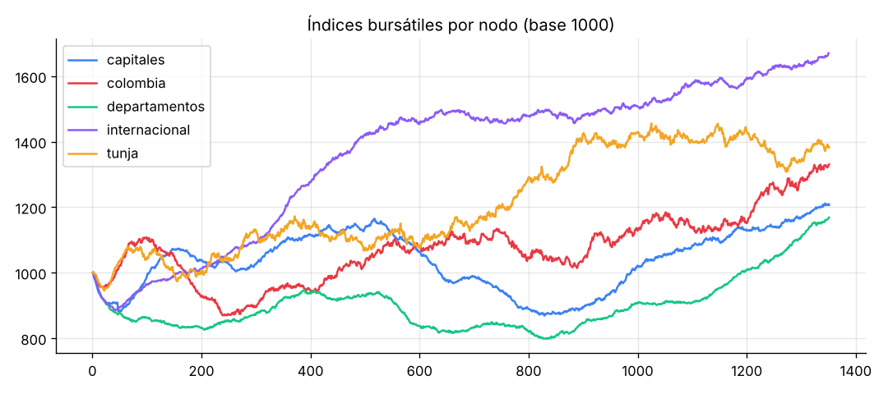
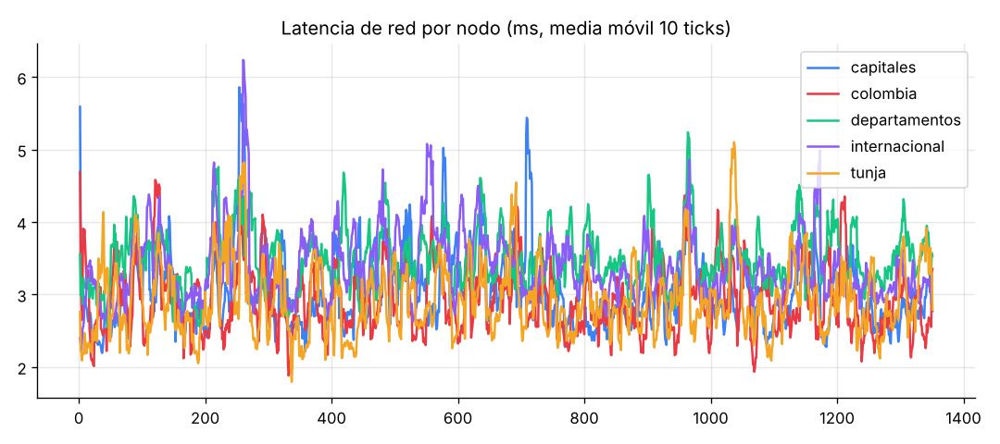
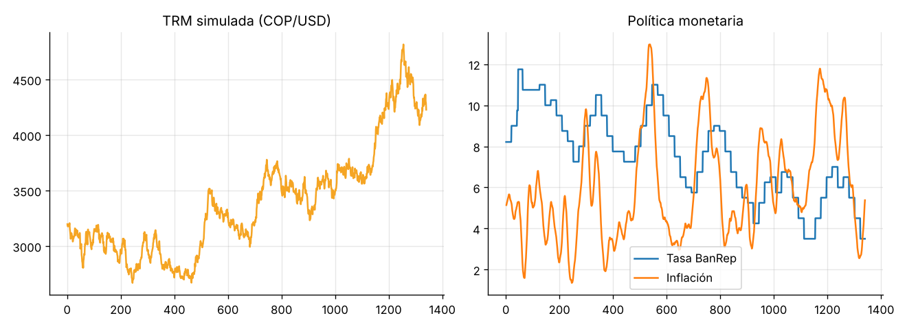

# Reporte de la corrida `20261030-143342`

Ticks simulados: **1351** (≈ 5.4 años hábiles).

## 1. Simulación vs. datos oficiales

| Indicador | Dato real | Simulación | Fuente |
|---|---|---|---|
| Volatilidad diaria TRM | 0.782% | 0.873% | Banco de la República (datos.gov.co) |
| Inflación Colombia (% anual) | 5.14 | 4.31 | Banco Mundial FP.CPI.TOTL.ZG |
| Desempleo Colombia (%) | 8.29 | 28.25 | Banco Mundial SL.UEM.TOTL.ZS |
| Tasa de política (%) | 8.21 (Taylor) | 3.50 | Estimada con regla de Taylor |

## 2. Empresas: quiebras y emprendimiento

```
tipo           choque  nueva_empresa  quiebra
nodo                                         
capitales           0             15       12
colombia            0             12        8
coordinador         2              0        0
departamentos       0             35       17
internacional       0             27       15
tunja               0             28       11
```

## 3. Desigualdad (Gini de riqueza por nodo)

```
               gini_inicial  gini_final
nodo                                   
capitales             0.741       0.614
colombia              0.719       0.635
departamentos         0.748       0.635
internacional         0.732       0.674
tunja                 0.748       0.623
```

## 4. Contagio entre mercados (correlación de retornos diarios de los índices)

```
nodo           capitales  colombia  departamentos  internacional  tunja
nodo                                                                   
capitales           1.00      0.04           0.09           0.09  -0.00
colombia            0.04      1.00           0.02           0.05   0.04
departamentos       0.09      0.02           1.00           0.10   0.05
internacional       0.09      0.05           0.10           1.00   0.06
tunja              -0.00      0.04           0.05           0.06   1.00
```



## 5. Red y cómputo distribuido

```
               computo_ms  red_ms  red_p95_ms  ordenes_remotas_enviadas  ordenes_remotas_recibidas
nodo                                                                                              
capitales           29.11    3.04        5.42                     25151                      15332
colombia            20.97    2.93        5.99                     16427                       6719
departamentos       34.52    3.50        5.51                     15757                      33243
internacional       35.45    3.39        5.28                     22487                      24551
tunja               22.96    2.92        6.00                     14474                      14402
```

`red_ms` = ida y vuelta del tick menos el tiempo de cómputo del nodo: es el costo de la red.



## 6. Macroeconomía



Activos cotizando al final: **103**; volumen total negociado: **879,414,674** acciones.
